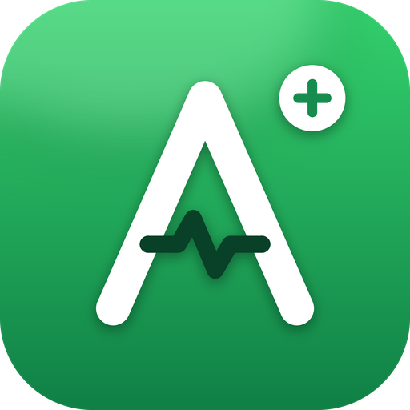

<div align="center">



# ActivityPlus

**Personal finance made simple.** Track income, expenses, wallets, budgets and savings goals in one clean, secure app.


</div>

---

## Overview

ActivityPlus is a lightweight, framework-free web app for managing personal money. It supports multiple currencies, multiple wallets, monthly budgets and savings goals, and gives you clear analytics and a downloadable PDF report. Data is stored per user in Supabase and protected with authentication.

## Features

| Area | What you get |
| --- | --- |
| **Dashboard** | Balance, income, expenses and savings at a glance, with recent activity |
| **Transactions** | Add, edit, delete, search and filter by category; transfers between wallets |
| **Wallets** | Multiple wallets with live balances |
| **Budgets** | Per-category budgets with spending progress |
| **Savings Goals** | Create goals and add to them as you save |
| **Analytics** | Spending by category and income vs. expense summaries |
| **Multi-currency** | USD, SLSH and ETB |
| **Reports & Backup** | PDF report, CSV export, JSON backup and restore |
| **Security** | Email/password login, plus PIN and password confirmation before deleting or resetting data |
| **Experience** | Responsive layout (desktop, tablet, mobile), dark mode, loading states on every save/load |

## Tech Stack

- **Frontend:** HTML, CSS and vanilla JavaScript (no framework, no build step)
- **Backend:** [Supabase](https://supabase.com) (PostgreSQL + Auth)
- **PDF:** jsPDF and jsPDF-AutoTable
- **Icons & font:** Phosphor Icons, Plus Jakarta Sans
- **Hosting:** Vercel (any static host works)

## Project Structure

```
ActivityPlus-main/
├── index.html      # App markup (login, dashboard, modals)
├── style.css       # Design system, responsive layout, dark mode
├── script.js       # App logic, Supabase auth + data, PDF report
├── assets/         # Logo, favicons, app icons
└── README.md
```

## Getting Started

### 1. Run locally

No build step is needed. Serve the folder with any static server:

```bash
# Python
python3 -m http.server 8080

# or Node
npx serve .
```

Then open `http://localhost:8080`.

### 2. Connect your own Supabase project

1. Create a project at [supabase.com](https://supabase.com).
2. In `script.js`, set your own values:

   ```js
   const SUPABASE_URL = "https://YOUR-PROJECT.supabase.co";
   const SUPABASE_KEY = "YOUR-PUBLISHABLE-KEY";
   ```

3. Create the data table and enable Row Level Security so each user can only access their own data:

   ```sql
   create table if not exists public.activityplus_data (
     user_id    uuid primary key references auth.users (id) on delete cascade,
     data       jsonb not null default '{}'::jsonb,
     updated_at timestamptz not null default now()
   );

   alter table public.activityplus_data enable row level security;

   create policy "Users manage their own data"
     on public.activityplus_data
     for all
     using (auth.uid() = user_id)
     with check (auth.uid() = user_id);
   ```

4. In **Authentication**, create your user (email + password).

> Only use the **publishable (anon)** key in the frontend. Never put a service-role key in client code.

### 3. Deploy to Vercel

1. Push the project to GitHub.
2. Import the repository in [Vercel](https://vercel.com).
3. Framework preset: **Other**. No build command, output directory is the project root.
4. Deploy.

## Security Notes

- Row Level Security must be enabled so users can only read and write their own row.
- Destructive actions (delete, reset) require the local PIN and the account password.
- The PIN is a convenience guard stored in the browser; real data protection comes from Supabase Auth and RLS.

## Roadmap

- [ ] Recurring transactions
- [ ] Category management
- [ ] Charts export
- [ ] Installable PWA (offline support)

## License

All rights reserved. Contact the author before reusing or redistributing.

---

<div align="center">
Built with care by <strong>Abdihakim</strong>
</div>
